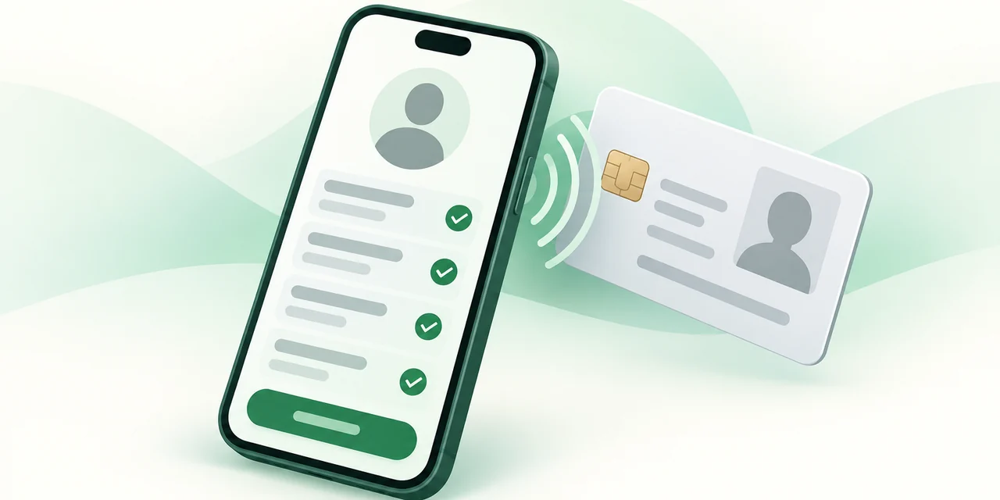
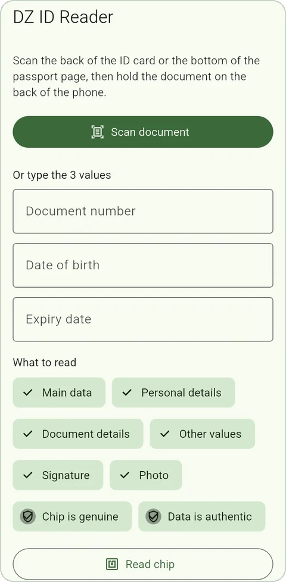
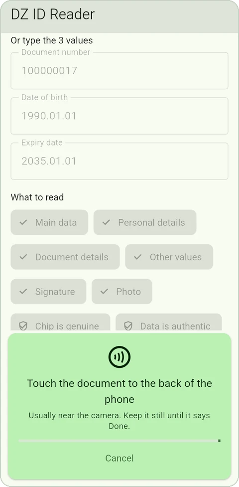
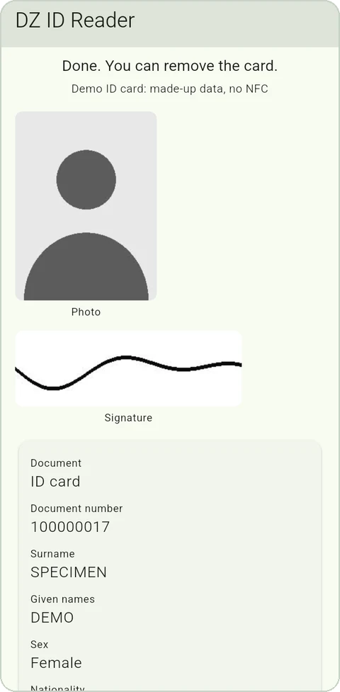
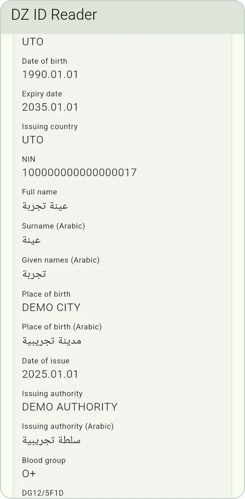
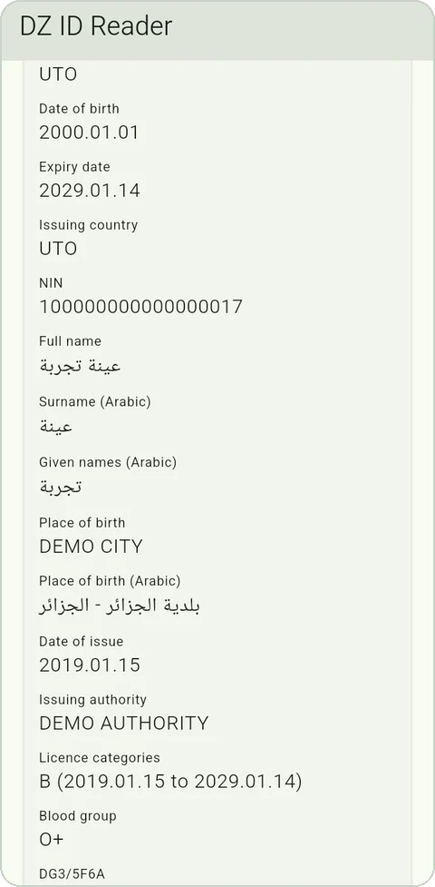
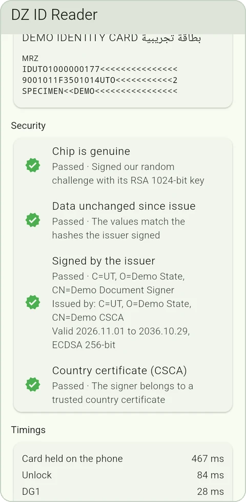
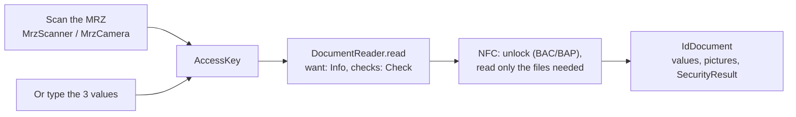

<p align="center">
  
</p>

<h1 align="center">dz_id_reader</h1>

<p align="center">
  Read the chip of Algerian ID cards, driving licences and passports over NFC,<br>
  in your own Flutter screens, reading only what you need.
</p>

<p align="center">
  
  
  
  
  
</p>

Private Flutter package (Android) that reads the chip of Algerian ID cards,
passports and driving licences over NFC, and scans the MRZ with the camera
to get the key that unlocks the chip.

- **No screens.** The package returns data, progress and typed errors. Your
  app draws every page, in its own language.
- **Reads only what you ask for.** Each value lives in a chip file; the
  reader reads only the files that hold what you asked for, and returns
  only those values. Text alone takes about 0.15 s on an Algerian ID card.
- **Checks authenticity** (optional): the chip proves it is not a copy, and
  the data matches what the state signed.
- **Arabic and Latin.** Names, place of birth and issuing authority come in
  both scripts, as the Algerian documents store them.
- **Nothing leaves the phone.** No storage, no network, no personal data in
  logs.

## Screens

The example app (`example/`) is built only on the public API: your app can
look completely different. Shown with the made-up demo cards.

<table>
  <tr>
    <td align="center"><br><sub>Choose what to read</sub></td>
    <td align="center"><br><sub>Your own "touch the card" panel</sub></td>
    <td align="center"><br><sub>Photo, signature, values</sub></td>
  </tr>
  <tr>
    <td align="center"><br><sub>Arabic and Latin values</sub></td>
    <td align="center"><br><sub>Driving licence</sub></td>
    <td align="center"><br><sub>Security checks</sub></td>
  </tr>
</table>

## How it works



## Add it to an app

```yaml
dependencies:
  dz_id_reader:
    git:
      url: https://github.com/aniszouagh/dz_id_reader.git
      ref: v0.1.0
```

The repository is private: the machine that builds the app needs read access
to it (your GitHub login, or a deploy key on a CI server).

Android setup:

- `minSdk` 24 or higher.
- NFC permission: added by the package. NFC is not marked as required, so
  phones without NFC can still install the app (they can still scan the
  MRZ).
- Camera permission: added by the `camera` package, which also asks for the
  microphone and storage. Scanning uses neither; to drop them, add this to
  the app's `AndroidManifest.xml` (with
  `xmlns:tools="http://schemas.android.com/tools"` on `<manifest>`):

  ```xml
  <uses-permission android:name="android.permission.RECORD_AUDIO" tools:node="remove"/>
  <uses-permission android:name="android.permission.WRITE_EXTERNAL_STORAGE" tools:node="remove"/>
  ```

- Release builds: the ProGuard rules the package needs are included.
- No change to `MainActivity`.

## Read a document

```dart
import 'package:dz_id_reader/dz_id_reader.dart';

final reader = DocumentReader();

try {
  final doc = await reader.read(
    AccessKey(
      documentNumber: '123456789',
      dateOfBirth: DateTime(1990, 1, 1),
      dateOfExpiry: DateTime(2030, 1, 1),
    ),
    want: {Info.names, Info.nin},       // reads 2 small files
    checks: {Check.chipGenuine},        // optional
    onProgress: (p) => setState(() => progress = p),
  );
  print('${doc.surname} ${doc.nin}');   // doc.photo is null: never read
} on WrongKey {
  // "Check the document number and the dates"
} on CardMoved {
  // "Hold the card still"
} on NfcOff {
  await reader.openNfcSettings();
} on ReadException catch (e) {
  // NfcNotSupported, NoCardFound, UnsupportedDocument, ReadCancelled, ChipError
}
```

`ReadException` is sealed, so a `switch` over it must handle every case.

### What you can ask for

Each value lives in a chip file; times are from real reads (release build,
Redmi 14C).

ID card and passport (ICAO 9303):

| `Info` | File | Algerian ID card |
|---|---|---|
| `documentType`, `documentNumber`, `names`, `sex`, `nationality`, `dateOfBirth`, `dateOfExpiry`, `issuingCountry`, `mrz` | DG1 | 0.15 s, unlock included |
| `nin`, `fullName` (Arabic), `namesArabic`, `placeOfBirth`, `placeOfBirthArabic`, `bloodGroup`, `otherNames`, `address` | DG11 | + 0.09 s |
| `dateOfIssue`, `issuingAuthority` | DG12 | + 0.05 s |
| `otherDetails` (other DG11/DG12 values, by tag) | DG11 + DG12 | |
| `signature` | DG7 | + 0.6 s |
| `photo` | DG2 | + 1.8 s |

Driving licence (ISO/IEC 18013, Algerian layout):

| `Info` | File | Algerian licence |
|---|---|---|
| `documentNumber`, `names`, `dateOfBirth`, `dateOfIssue`, `dateOfExpiry`, `issuingCountry`, `issuingAuthority`, `licenceCategories` | DG1 | 0.4 s, unlock included |
| `sex`, `placeOfBirth` | DG2 | + 0.13 s |
| `nin` | DG3 | + 0.14 s |
| `mrz`, `nationality`, `bloodGroup`, `fullName`, `namesArabic`, `placeOfBirthArabic` | DG11 | + 0.28 s |
| `otherDetails` (the Arabic fields of DG11 and the rest, by tag) | DG3 + DG11 | |
| `signature` | DG5 | + 3.6 s |
| `photo` | DG4 | + 10.4 s |

The licence chip is slow (about 0.15 s per command) and refuses big reads,
hence its slow pictures. `documentType` is known without reading anything.

Algerian layouts the package handles:

- ID card DG11 writes the surname (5F0E), given names (5F0F) and place of
  birth (5F11) in Latin, then Arabic, and keeps the sex and blood group in
  5F42 (where ICAO puts the address: the card holds no address). DG12
  writes the issuing authority (5F19) in Latin then Arabic, and the expiry
  date in full (5F1B). Its Arabic is in ISO-8859-6, not UTF-8 (the reader
  also handles Windows-1256, and detects which per file).
- Licence DG11 holds the Arabic surname (5F37), given names (5F38) and
  place of birth (5F39), the blood group (5F36) and the MRZ (5F3D). A
  wilaya name in Arabic and Latin (5F3A, 5F3E) stays in `otherDetails`:
  on the card tested, the wilaya of birth and of issue were the same, so
  which one it is is not known yet.

Ready-made sets: `Info.mrzData` (the default), `Info.personalDetails`,
`Info.documentDetails`, `Info.allText`, `Info.everything`.

### Checks

| `Check` | What it proves | Cost |
|---|---|---|
| `chipGenuine` | The chip signs a random challenge with a key that cannot be copied out of it: it is the original chip (Active Authentication, DG15). The Algerian licence has no such key (`notSupported`). | + 0.1 s on the ID card |
| `dataAuthentic` | The values read match the hashes the issuer signed, and the signature is valid (passive authentication, EF.SOD). | + 0.2 s on the ID card, 1.3 s on the licence, then about 0.05 s of checking |

Results are in `doc.security` as `CheckStatus` values (`passed`, `failed`,
`notSupported`, `notChecked`), with the document signer's certificate.

To also prove that the signer belongs to the state, give the reader the
country's CSCA certificates (DER):
`DocumentReader(trustedCountryCertificates: [cscaDer])`. Without them,
`security.countryCertificate` is `notChecked`.

### Progress and partial results

`onProgress` gets a `ReadProgress`: the stage (`waitingForCard`,
`unlocking`, `reading`, `checking`, `done`), the attempt number (it goes up
when the card moved and the reader waits for it again), a `fraction` from 0
to 1 for a progress bar, and `partial`: the values read so far, so you can
show the name while the photo is still loading.

If the card moves away, the reader waits for it and goes on where it
stopped, until the timeout (30 s by default). Big files are read in 2 KB
pieces when the phone and the chip take extended-length commands; a chip
that refuses them gets 960-byte or short pieces, in the same connection,
and the reader remembers that for the next reads of the document.

### Pictures

`doc.photo` and `doc.signature` are `DocumentImage`s (JPEG or JPEG 2000).
`await image.toDisplayBytes()` gives bytes for `Image.memory` (JPEG 2000 is
converted to PNG on a background isolate); `await image.decode()` gives a
`ui.Image`.

The face photo is biometric data: under Law 18-07 it is sensitive. Read it
only when the use needs it, and store it only with the person's consent.

### NFC tips

- `await reader.nfcState()`: `notSupported`, `off` or `on`.
- Call `reader.holdNfc()` when your read page opens and
  `reader.releaseNfc()` when it closes. In between, a card that touches the
  phone outside a read is ignored, so Android does not show its own "cannot
  read this tag" message, and a card already on the phone is used at once
  when the read starts.
- `reader.cancel()` stops a read (it throws `ReadCancelled`).

## Scan the MRZ (no typing)

```dart
import 'package:dz_id_reader/scanner.dart';
```

- `MrzScanner` has no UI. Feed it frames from your own camera code:
  `addCameraImage` (frames of the `camera` package, started with
  `ImageFormatGroup.nv21`), `addNv21` (any camera code), or `addTextLines`
  (any OCR). It returns an `MrzScanResult` with the `AccessKey` once found.
  `progress` tells which values are found so far, for your hints.
- `MrzCamera` is an optional helper that opens the back camera with the
  settings that work best and feeds the scanner. Your page shows
  `CameraPreview(camera.controller!)` and draws its own outline, using
  `camera.cardArea`.
- Call `MrzScanner.warmUp()` early (app start, or when the identity step
  opens): loading the OCR model takes about a second.

```dart
final camera = MrzCamera();
await camera.start();                 // CameraException if refused
// build: CameraPreview(camera.controller!, child: yourOverlay)
final result = await camera.result;
final doc = await reader.read(result.key);
await camera.dispose();
```

A frame whose whole MRZ passes the composite check digit is accepted at
once; otherwise every value must pass its own check digit in two frames.
Frames stay in memory; no picture is taken or saved.

## Tests and demos without a card

```dart
import 'package:dz_id_reader/testing.dart';

final reader = DocumentReader(transport: FakeNfc(FakeCard.demo()));
final doc = await reader.read(demoKey, want: Info.everything);
```

`FakeCard` simulates a chip, with BAC, secure messaging, big reads (or
their refusal) and Active Authentication. `FakeCard.demo()` is a made-up
"SPECIMEN DEMO" ID card of the fictional state UTO, with the Algerian
layout, signed under `demoCountryCertificate`; `FakeCard.demoLicence()` (key `demoLicenceKey`)
is a made-up licence with the Algerian layout. Use them in widget tests,
and to work on screens without a card.

## Status

- Android only.
- ID card: tested on a real Algerian card.
- Driving licence: tested on a real Algerian licence.
- Passport: not tested yet. Chips that only accept PACE (the newer unlock)
  are not supported yet.

## Development

- `flutter test` runs the tests. They include the BAC and secure messaging
  worked example of ICAO Doc 9303 part 11, and full reads against the fake
  chip.
- `python3 -I tool/make_test_fixtures.py` regenerates the test fixtures and
  the demo card (needs openssl, ffmpeg and the Python `cryptography`
  package).
- `example/` is the test app: scan, choose what to read, read, and see the
  values, checks and timings. It also has a demo card button.
